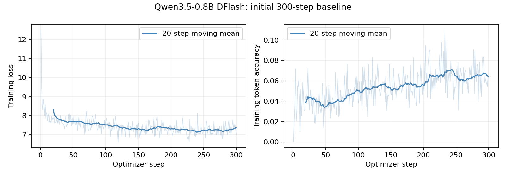

# Initial Qwen3.5-0.8B DFlash baseline

Frozen target: Qwen/Qwen3.5-0.8B. Five-layer DFlash draft (86,522,368
parameters), block size 16, standard target decoder layers [1,6,11,16,21].

## Training

UltraChat train_sft: 1200 valid examples from a seeded
8192-example subset, 300 optimizer steps, accumulation 4, length 512.
Target hidden states were computed live on every microbatch; labels were
UltraChat assistant answers, not regenerated target answers. Frozen target,
FP32 draft parameters with FP16 autocast, SDPA on Tesla T4.

- Successful optimizer updates: 300/300.
- Training time: 376.91 s.
- Peak allocated GPU memory: 3.546 GB.
- Filtered examples (insufficient assistant tokens after truncation): 126.
- Held-out teacher-forced validation: 64 conversations,
  mean example loss 7.17156,
  mean example token accuracy 6.31%.

## Draft benchmark

64 seeded GSM8K test prompts; greedy target completions,
thinking disabled, maximum 256 new tokens.
Sample 16 full DFlash blocks per eligible target trajectory, using identical
trajectories and anchor RNG seeds for the trained and untrained drafts.

| Measurement | Untrained draft | 300-step draft |
| --- | ---: | ---: |
| Mean accepted length, including anchor | 1.000000 | 1.132812 |
| Draft token accuracy on target continuations | 0.03% | 5.47% |

Paired per-question mean acceptance improvement:
0.132812 tokens,
95% bootstrap interval [0.112305, 0.153320] (seed 42, 10000 resamples).
Length 1 is the anchor-only floor; length 16 is a fully accepted block.

The frozen target's capped GSM8K exact match was 39.06%.
40/64 outputs reached the token
limit. This is a capped diagnostic, not a complete GSM8K task-quality estimate.

## Interpretation and next experiment

This short run establishes an initial, reproducible baseline. Acceptance near
the anchor-only floor is weak; falling loss does not establish useful decoding
acceleration or convergence. End-to-end speculative serving speed was not
measured. Hybrid Qwen3.5 caches require a compatible serving implementation;
generic KV cache cropping is unsafe.

Before drawing layer-importance conclusions, train to a defensible validation
plateau, then repeat with all 24 target decoder features under the same budget,
data, seed, draft depth and benchmark. The all-layer path passed a one-update
GPU smoke test (106,445,312 trainable parameters); it has not completed a matched
training experiment. Importance should be measured using paired layer ablations,
not inferred solely from projection weight norms.

## Artifacts

- Final weights and optimizer/RNG state:
  `outputs/qwen35_08b_dflash/baseline-standard-layers/step-300/`.
- Full target predictions and token trajectories:
  `outputs/qwen35_08b_dflash/baseline-standard-layers/gsm8k_predictions.jsonl`.
- Git tracks this report, metrics, manifests, summaries and the plot. Large model
  weights and full generated texts remain local under ignored cache/outputs.
- Reproduction commands: ../README.md. Persistent handover: ../PROGRESS.md.
